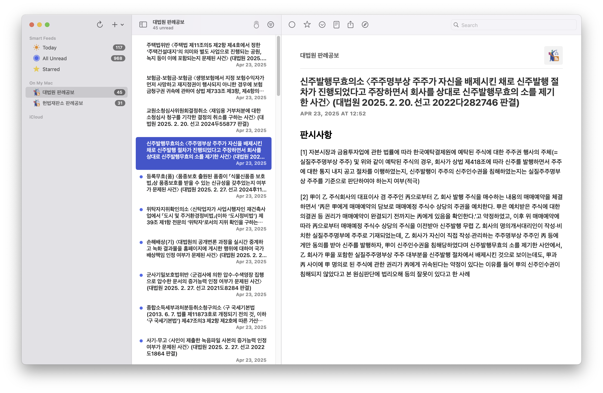

# casefeed

법원 판례공보를 RSS로 제공하는 서비스

## 라이선스

이 저장소는 [AGPL-3.0-or-later](./LICENSE)로 배포합니다.

단, `court-api/`는 [MIT](./court-api/LICENSE-MIT) 또는 [Apache-2.0](./court-api/LICENSE-APACHE) 중 원하는 쪽을 선택해 사용할 수 있습니다.
